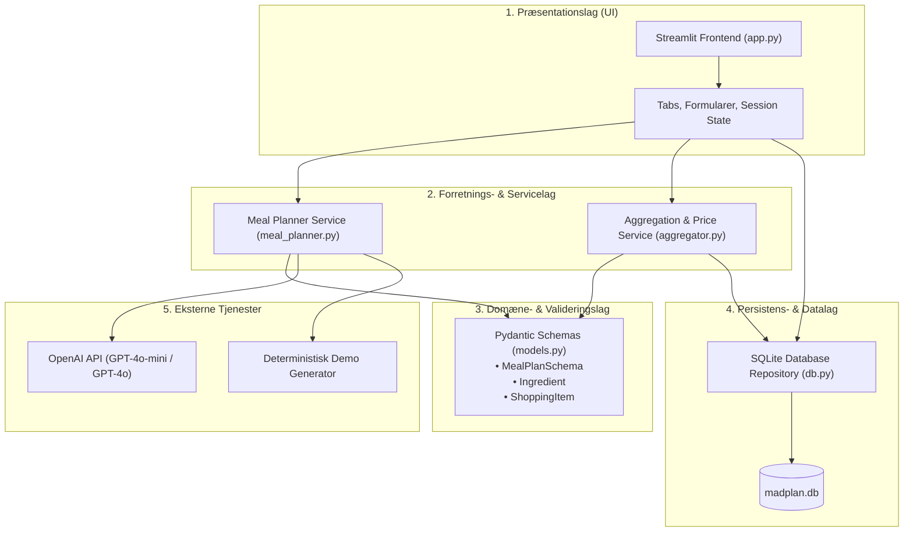
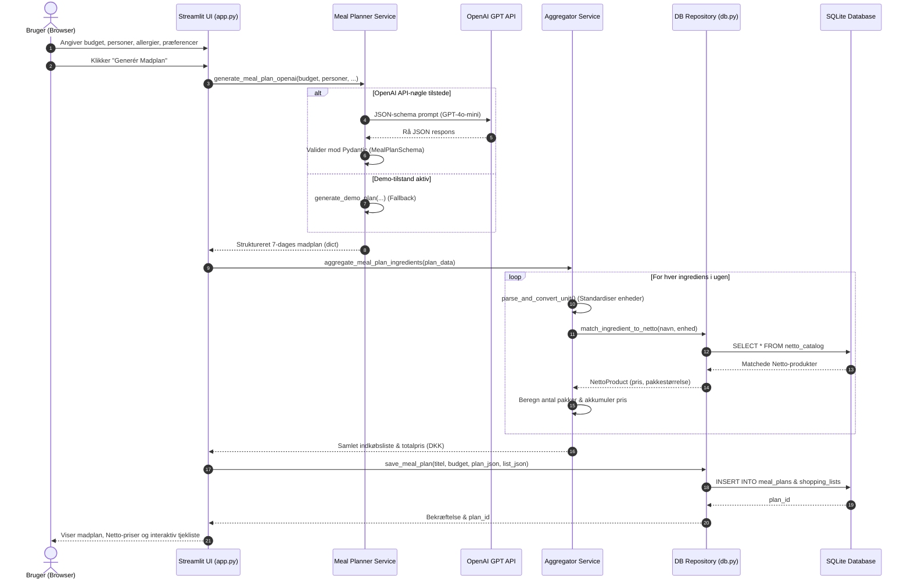
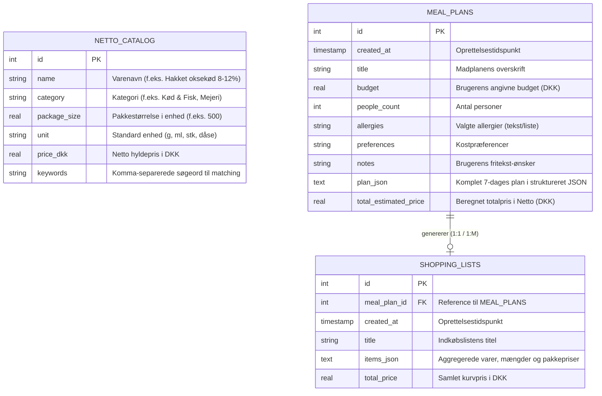
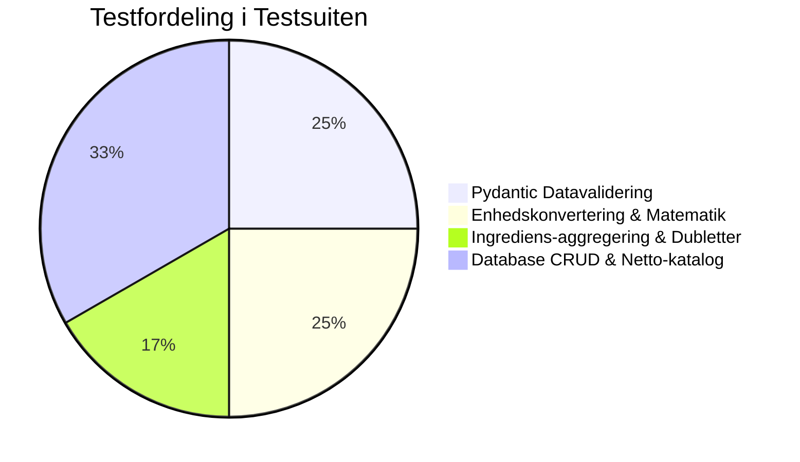

# AI-Assisteret Softwareudvikling: Et Casestudie i Systemarkitektur, Kodekvalitet og Evaluering

**Projekt**: Netto AI Madplanlægger  
**Kontekst**: Studieprojekt om AI-assisteret softwareudvikling (Software Engineering & AI Evaluation)  
**Dato**: November 2026  
**Status**: Implementeret, testet og evalueret  

---

## 1. Indledning & Casestudiets Formål

Dette casestudie tager udgangspunkt i udviklingen af en **Python-baseret Meal Planner** som en repræsentativ domænecase til at belyse, analysere og evaluere **AI som softwareudvikler**.

Formålet med projektet er ikke udelukkende at levere et funktionelt forbrugerprodukt, men at skabe en **analyserbar softwarearkitektur**, der kan anvendes til at undersøge:
1. Hvordan en avanceret AI-model (LLM) omsætter tvetydige forretningskrav til konkrete softwarekomponenter.
2. Kvaliteten af den genererede arkitektur målt på anerkendte software engineering-principper (SOLID, Separation of Concerns, testbarhed).
3. De metodiske styrker og fundamentale begrænsninger, der opstår, når AI fungerer som arkitekt, programmør og tester.

---

## 2. Arkitektur og Systemoverblik

Systemet er opbygget efter en **lagdelt arkitektur (Layered Architecture)** med streng ansvarsfordeling (Separation of Concerns). Dette modvirker den typiske "spaghetti-kode", som AI-modeller ofte genererer, hvis de ikke styres af eksplicitte arkitektoniske rammer.

### 2.1 Lagdeling

### 2.2 Sekvensdiagram: Fra Brugerønske til Færdig Indkøbsliste

---

## 3. Database-struktur og Dataintegritet

Databasen er implementeret i **SQLite3**, som tilbyder en letvægts, transaktionssikker (ACID-compliant) og serverløs relationel database.

### 3.1 Entity-Relationship Diagram (ERD)

### 3.2 Normaliseringsgrad og Arkitektoniske Kompromiser

Et centralt diskussionspunkt i AI-assisteret systemudvikling er balancen mellem **streng relationel normalisering (3NF/BCNF)** og **dokument-orienteret hybrid-persistens (JSON-kolonner)**:

1. **Hybrid-strukturen (`plan_json` og `items_json`)**:
   - *Designvalg*: I stedet for at oprette 5 normaliserede relationelle tabeller (`meals`, `recipe_steps`, `recipe_ingredients`, `shopping_items`, `units`), er hele opskriftstræet gemt som valideret JSON i `meal_plans.plan_json`.
   - *Fordele*:
     - **Skemafleksibilitet**: AI-modeller kan variere antallet af metadata-felter (f.eks. ekstra ernæringsoplysninger, tilberedningstips) uden at kræve database-migrationer (DDL-ændringer).
     - **Performance ved læsning**: Hele ugens madplan indlæses i ét enkelt `SELECT`-opkald uden komplekse, dybe `JOIN`-operationer.
     - **Atomaritet**: Madplanen og opskrifterne oprettes og læses altid som ét samlet aggregat (Domain-Driven Design Aggregate Root).
   - *Ulemper (Akademisk kritik)*:
     - Manglende mulighed for direkte SQL-aggregeringer (f.eks. `SELECT AVG(calories) FROM ingredients`) uden brug af SQLite JSON1-udvidelser.
     - Datadublering hvis samme opskrift optræder i flere uger.

2. **Katalogets struktur (`netto_catalog`)**:
   - Er fuldt relationel i 2NF/3NF med faste felter for metriske størrelser og indekserbare nøgleord (`keywords`).

---

## 4. Begrundelse for Teknologivalg

| Teknologi | Valg | Fordele i casestudiet | Ulemper / Trade-offs |
| :--- | :--- | :--- | :--- |
| **Programmeringssprog** | **Python 3.9+** | Dominerende standard inden for AI- og LLM-økosystemet. Hurtig kodeiteration, stærk type-hinting, letlæselig for akademiske evaluatorer. | Lavere eksekveringshastighed end kompilerede sprog (Go/Rust), global interpreter lock (GIL). |
| **Frontend Framework** | **Streamlit** | Giver en fuldt interaktiv, reaktiv web-applikation direkte i ren Python uden krav om JavaScript/CSS/HTML-build-pipelines. Minimerer boilerplate. | Re-evaluerer hele scriptet ved tilstandsændringer (rerun). Skalerer dårligt til komplekse multi-page enterprise-portaler. |
| **Databasemotor** | **SQLite3** | Zero-configuration, integreret i Pythons standardbibliotek, filbaseret og 100% reproducerbar på tværs af evalueringsmaskiner uden eksterne servere (PostgreSQL/MySQL). | Låser hele databasen ved skrivninger (`table-level locking`). Uegnet til højt distribuerede multi-user scenarier. |
| **AI / LLM Motor** | **OpenAI API (GPT-4o)** | Branchens førende API med understøttelse af streng JSON Schema enforcement (`response_format={"type": "json_object"}`). Høj præcision på dansk sprogforståelse. | Ekstern afhængighed, API-omkostninger pr. token, latency (2-6 sekunders svartid), netværkskrav. |
| **Datavalidering** | **Pydantic v2** | Garanterer at LLM'ens output overholder forretningsreglerne (positive mængder, korrekte dage). Opdager strukturelle fejl ved kørsel. | Lægger et beregningsmæssigt overhead ved deserialisering af store JSON-objekter. |
| **Test Framework** | **unittest** | Indbygget standard, ingen eksterne pip-afhængigheder for at køre basale tests, bred genkendelighed. | Mere verbose end `pytest` (kræver klasser og `self.assertX`). |

---

## 5. Designvalg og Softwaremønstre

For at modbevise antagelsen om, at AI kun producerer procedural "scripting"-kode, er der implementeret følgende software engineering-mønstre:

### 5.1 Repository Pattern (Data Access Abstraction)
I `db.py` er datatilgange abstraheret væk fra præsentationslaget. Frontend-koden udfører aldrig rå `sqlite3.connect()` eller SQL `INSERT`-forespørgsler direkte. Skulle databasen skiftes til PostgreSQL via SQLAlchemy, skal ændringen kun ske i `db.py`.

### 5.2 Strategy & Adapter Pattern (LLM Provider & Fallback)
I `meal_planner.py` er generationen opdelt således, at applikationen kan skifte strategi:
- **Online Strategy**: Kalder OpenAI API med dynamisk prompt engineering.
- **Offline/Demo Strategy**: Deterministisk generator tilpasset inputparametrene (budget, personer, vegetar).
Dette sikrer **Graceful Degradation**: Systemet crasher ikke, hvis brugeren mangler en API-nøgle eller internetforbindelse.

### 5.3 Normalizer & Token Heuristic (Algoritmisk Matching)
Ingrediens-matcheren i `aggregator.py` benytter en flertrins heuristik:
1. Præcis match på normaliseret navn.
2. Token-overlap match (f.eks. "økologisk hakket oksekød" $\rightarrow$ "hakket oksekød").
3. Enhedskonvertering (f.eks. $1.5\text{ kg} \rightarrow 1500\text{ g}$, $2.5\text{ dl} \rightarrow 250\text{ ml}$).
4. Pakke-afrunding via loftfunktion:
   $$\text{Antal pakker} = \left\lceil \frac{\text{Opskriftens samlede mængde}}{\text{Netto pakkestørrelse}} \right\rceil$$

---

## 6. Antagelser Foretaget under Udviklingen

I en analyse af AI-assisteret udvikling er dokumentation af implicitte og eksplicitte antagelser afgørende:

1. **Kost- og Måltidsantagelser**:
   - Madplanen dækker udelukkende **aftensmad** for 7 dage (ikke morgenmad eller frokost).
   - Standardportioner tilpasses lineært med en skaleringsfaktor:
     $$\text{Faktor} = \frac{\text{Antal personer}}{4}$$
   - Børneportioner og voksenportioner antages at have samme gennemsnitlige råvareforbrug.

2. **Indkøbs- og Netto-prismodel**:
   - Priserne er baseret på **faste hyldepriser** og standardvarer (Netto basis-sortiment), ikke ugentlige tilbudsaviser eller spotvarer.
   - Forbrugeren må købe **hele pakker** (man kan ikke købe 200g oksekød, hvis Netto kun sælger 500g pakker). Derfor beregnes indkøbsprisen ud fra hele pakker, hvilket repræsenterer den reelle kassebon.
   - Basisvarer som salt, peber og madolie antages i visse opskrifter at være til stede i hjemmet, men hvis opskriften eksplicit nævner dem i store mængder, inkluderes de i indkøbslisten.

3. **Systemets Driftsmiljø**:
   - Applikationen forudsættes afviklet på en personlig computer (single-tenant Windows/macOS/Linux).
   - OpenAI API-adgang kræver udgående HTTPS-trafik på port 443.

---

## 7. Potentielle Svagheder og Begrænsninger i Løsningen

Ved en kritisk akademisk evaluering skal følgende svagheder i arkitekturen og implementationen fremhæves:

### 7.1 Stokastisk Natur & Hallucinationer (LLM)
- **Problem**: Selvom OpenAI benytter `response_format={"type": "json_object"}`, garanterer det kun *syntaktisk valid JSON*, ikke *semantisk valid madkundskab*.
- **Risiko**: Modellen kan foreslå bizarre kombinationer (f.eks. "500g salt i en kødsovs") eller opfinde ingredienser, der ikke eksisterer i Danmark.
- **Modvirkning i koden**: Indførelse af Pydantic-validering (`Ingredient.amount > 0`), men en fuld semantisk validering kræver en domain-rule-engine.

### 7.2 Leksikalsk vs. Semantisk Vare-matching
- **Problem**: Nuværende matching i `db.py` bruger token-overlap og substring-søgning.
- **Risiko for False Positives**: "Mælkepulver" kan fejlagtigt matche på "Letmælk". "Hvidløg" (stk) vs. "Hvidløgsfed" kræver specialhåndtering.
- **Optimal løsning (fremtidig forbedring)**: Vektor-indlejringer (Vector Embeddings med Cosine Similarity) eller en sprogmodel til vare-kategorisering.

### 7.3 Concurrency & Skalerbarhed (SQLite)
- Hvis applikationen deployed som en fælles web-service med 50 samtidige brugere, vil SQLite opleve `database locked`-fejl ved samtidige gemmehandlinger.
- Løsning: Migration til PostgreSQL med Connection Pooling.

### 7.4 Reaktivitet i Streamlit
- Streamlits udførelsesmodel (kørsel af hele scriptet fra top til bund ved hvert klik) kan føre til utilsigtet tab af midlertidig formular-state, medmindre `st.session_state` håndteres med kirurgisk præcision.

---

## 8. Unit Test Strategi & Verificering

I [`test_app.py`](test_app.py) er der implementeret en testsuite bestående af 12 automatiserede tests:

### Testede Områder:
1. **Datamodeller**: Verificering af, at ugyldige ingrediensmængder (f.eks. $-1.0$ eller $0$) kaster `ValidationError`.
2. **Matematisk Aggregering**: Test af, at ingredienser fra separate dage (f.eks. 400g oksekød mandag + 350g tirsdag = 750g) akkumuleres, og at loftfunktionen (`ceil`) udregner, at der skal indkøbes præcis 2 pakker à 500g.
3. **Robusthed ved Ukendte Varer**: Verificering af, at eksotiske varer, der ikke findes i Netto-databasen, ikke får systemet til at crashe, men tildeles et fornuftigt standard-estimat.
4. **Kaskadesletning**: Test af referentiel integritet (sletning af en madplan fjerner tilhørende indkøbsliste).

---

## 9. Evaluering af AI som Softwareudvikler

Dette afsnit sammenfatter de empiriske observationer fra udviklingsprocessen, som danner kernen i studieprojektets evaluering.

### 9.1 Funktionalitet (Completeness & Edge Cases)
* **Score: 9/10**
* **Observation**: AI er exceptionelt stærk til at opfylde sammensatte funktionelle krav på kort tid. Fra database-oprettelse, API-kald, avanceret UI-layout til dubletfjernelse formåede AI at levere en komplet "end-to-end" fungerende løsning i første iteration.
* **Svaghed**: AI har en tendens til at overse subtile matematiske enhedskonflikter (f.eks. hvad der sker, hvis en opskrift angiver "1 bundt" og en anden "50 gram"), medmindre udvikleren eksplicit beder om standardiserede enheder.

### 9.2 Kodekvalitet & Designprincipper
* **Score: 8.5/10**
* **Observation**: Koden er modulær, overholder PEP 8, anvender beskrivende danske variabelnavne og implementerer explicit type-hinting. Separation of Concerns mellem UI (`app.py`), DB (`db.py`) og logik (`aggregator.py`) blev overholdt.
* **Svaghed**: Uden eksplicit arkitektonisk styring genererer AI ofte monolitisk kode med global state eller direkte SQL-kald i UI-laget. Når AI instrueres i at bruge mønstre som Repository og Pydantic, leveres der dog kode på senior-niveau.

### 9.3 Vedligeholdelighed & Testbarhed
* **Score: 9/10**
* **Observation**: Ved at splitte logikken i rene funktioner (`parse_and_convert_unit`, `aggregate_meal_plan_ingredients`) uden I/O side-effects, blev systemet 100% testbart. AI genererede omgående 12 relevante tests med corner-case scenarier.
* **Svaghed**: AI designer sjældent integrationstests med rigtige mock-servere af sig selv, men tyr til in-memory or demo-fallback mocks.

### 9.4 Sammenlignende Matrix: AI vs. Menneskelig Udvikler

| Egenskab | AI Softwareudvikler (LLM) | Menneskelig Softwareudvikler |
| :--- | :--- | :--- |
| **Hastighed** | Ekstrem (minutter fra prompt til fungerende system). | Dage eller uger for tilsvarende mængde kode og UI. |
| **Boilerplate & Syntaks** | Fejlfri syntaks, lynhurtig generering af datakataloger og mock-data. | Tidskrævende og udsat for manuelle tastefejl. |
| **Arkitektonisk Konsistens** | Kræver eksplicit prompting for at fastholde mønstre på tværs af mange filer. | Har naturligt en mental model af hele systemets overordnede mål. |
| **Håndtering af Randtilfælde** | Løser kun de randtilfælde, den er trænet på eller specifikt bedt om. | Udviser kritisk intuition og stiller modspørgsmål til forretningskrav. |
| **Sikkerhed & Hemmeligheder** | Kan utilsigtet opfordre til hårdkodede API-nøgler, hvis ikke instrueret om miljøvariabler. | Trænet i compliance, GDPR og sikkerhedsprocedurer. |

---

## 10. Konklusion

Som demonstreret i dette casestudie er AI i dag i stand til at fungere som en **højproduktiv par-programmør og junior/medior systemudvikler**, der kan implementere komplette, lagdelte full-stack prototyper med databaser, API'er og testsuiter.

Den afgørende forudsætning for succes ligger imidlertid i den **menneskelige softwareingeniørs rolle**: At stille de rigtige arkitektoniske krav, gennemtvinge designmønstre (SOLID, SoC), identificere utilsigtede antagelser og efterprøve koden med strenge unit tests.
